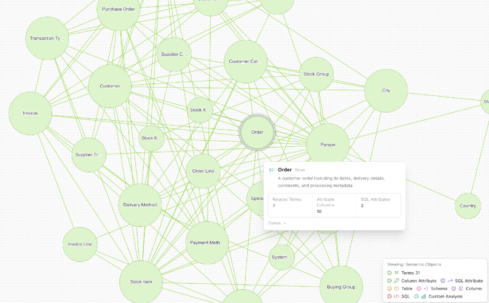
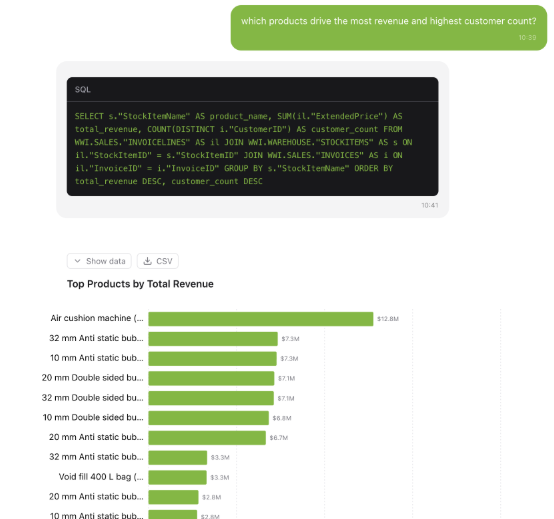
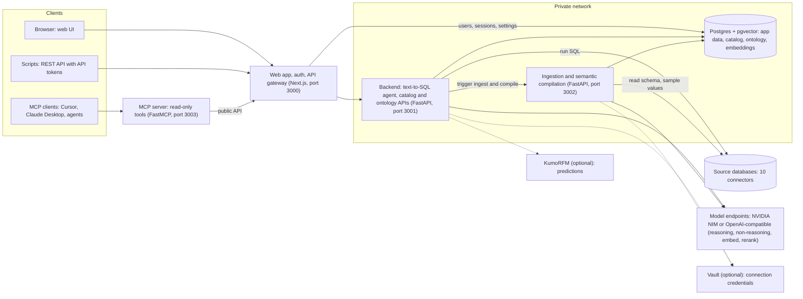

<!--
SPDX-FileCopyrightText: Copyright (c) 2026, NVIDIA CORPORATION & AFFILIATES.
All rights reserved.
SPDX-License-Identifier: Apache-2.0
-->

# Auto Ontology

[](https://beaverbench.github.io/#leaderboard)
[](https://bird-interact.github.io/)

Agents can retrieve documents and query databases, but reliability gates agentic analytics: a revenue metric answered faster is worth nothing if the number is wrong. Agents need context to answer accurately: what each business concept means, where it lives, how it connects, how to calculate it, where it comes from, and whether to trust it. An ontology holds that context: a shared, governed map from the concepts people ask about to the data behind them. NVIDIA Auto Ontology is an open library that builds that ontology automatically from enterprise metadata, reconciles definitions across systems, and exposes it to any agent harness through MCP, CLI, and API. It complements the semantic models customers already own, and [Apache Ossie](https://ossie.apache.org/) keeps it portable.

It enables developers to:

- **Discover:** generate enterprise ontologies from metadata; connect existing ontologies and semantic models; build AI-ready knowledge graphs.
- **Ground:** give agents trusted business meaning for metrics, entities, and relationships; reconcile inconsistent definitions across systems.
- **Validate:** test a draft with real questions before experts certify it; check generated queries against the catalog and the definitions retrieval surfaced; return the SQL and steps with every answer.
- **Expose:** serve context to any agent harness through MCP, CLI, and API.
- **Learn:** fold certified corrections and usage back into the ontology, so shared context improves with use.

An ontology matters most when:

- questions are varied, open-ended, and ambiguous;
- data spans many disparate sources with overlapping or conflicting
  definitions;
- meanings must be reused and governed across runs, teams, and agents;
- the model or its context budget can't hold the full documentation;
- users ask in business terms and need routing to the right source and grain.

With one well-modeled source and a fixed set of questions, direct SQL may be
enough.

## Quickstart

This runs Auto Ontology with Docker Compose against Wide World Importers,
Microsoft's sample sales database. You need Docker with Compose v2,
[uv](https://docs.astral.sh/uv/), and an NVIDIA API key (`nvapi-...`) from
[build.nvidia.com](https://build.nvidia.com).

1. Clone the repository and create `.env`:

   ```bash
   git clone https://github.com/NVIDIA/auto-ontology.git && cd auto-ontology
   cp .env.example .env
   ```

   Then set these values in `.env`:

   ```dotenv
   DEFAULT_MODELS_API_KEY=nvapi-...
   AUTH_SECRET=<a long random string, e.g. from openssl rand -base64 32>
   APP_URL=http://localhost:3000
   POSTGRES_PASSWORD=<a new password>
   CONNECTION_STRINGS=postgresql://postgres:<the same password>@postgres:5432/wideworldimporters
   AUTO_ONTOLOGY_ADMIN_PASSWORD=<a new password>
   PGADMIN_PASSWORD=<a new password>
   ```

   Compose publishes Postgres, pgAdmin, and the web app on the host, so replace
   each default password before you start it. `.env.example` also sets an API
   key per model role: replace each `nvapi-your-api-key-here` with your key, or
   delete those lines so they fall back to `DEFAULT_MODELS_API_KEY`.

2. Start Postgres and load the sample database. The seed script lives in
   auto-ontology-eval; pass it the Postgres password you set:

   ```bash
   docker compose up -d --wait postgres
   git clone https://github.com/NVIDIA/auto-ontology-eval.git ../auto-ontology-eval
   (cd ../auto-ontology-eval && uv sync && cp .env.example .env && \
     POSTGRES_PASSWORD='<the same password>' \
     uv run python scripts/seed/seed_wwi.py --database-name wideworldimporters --drop)
   ```

3. Build and start the rest of the stack:

   ```bash
   docker compose up -d --build
   ```

4. Open <http://localhost:3000> and sign in with `AUTO_ONTOLOGY_ADMIN_EMAIL` and
   `AUTO_ONTOLOGY_ADMIN_PASSWORD` from `.env`. Go to **Settings → Semantic
   Compilation** and turn it on. Ingestion runs at startup; compilation starts
   immediately and reports **Semantic compilation is ready** when it finishes.

5. Ask a question in **Chat**:

   > What was revenue for the USB food flash drive - sushi roll in Pennsylvania
   > in June 2015?

   The agent resolves *revenue*, *product*, and *state* to terms in the
   ontology, follows their relationships to the joins it needs, and runs the
   query. The answer comes back with its SQL and the steps that produced it,
   so you can check the result against the source:

   ```text
   Answer:  Revenue for USB food flash drive - sushi roll in Pennsylvania in
            June 2015 was $588.80, from 3 invoice lines.

   SQL:     SELECT SUM(il.extendedprice) AS revenue, COUNT(*) AS invoice_lines
            FROM sales.invoicelines il
            JOIN sales.invoices i             ON il.invoiceid = i.invoiceid
            JOIN warehouse.stockitems si      ON il.stockitemid = si.stockitemid
            JOIN sales.customers c            ON i.customerid = c.customerid
            JOIN application.cities ct        ON c.deliverycityid = ct.cityid
            JOIN application.stateprovinces sp ON ct.stateprovinceid = sp.stateprovinceid
            WHERE si.stockitemname = 'USB food flash drive - sushi roll'
              AND sp.stateprovincename = 'Pennsylvania'
              AND i.invoicedate >= '2015-06-01' AND i.invoicedate < '2015-07-01'

   Steps:   Resolved terms: Invoice Line (revenue), Stock Item, State Province, Invoice
            Joined: invoice line -> invoice -> customer -> city -> state province
            Validated the filter values against the data, then executed
   ```

6. Ask something the data can't answer. Wide World Importers has no
   advertising data, so a question about ad spend has nothing to resolve
   against. An agent connected through [MCP](#mcp-server) checks answerability
   first and asks you to clarify:

   ```text
   You:    What was return on ad spend for the sushi roll flash drive in June 2015?
   Agent:  check_answerable -> coverage 0.5; no term covers "ad spend"
   Agent:  I can find revenue for that product, but this data has no
           advertising spend, so I can't compute return on ad spend. Do you
           want June 2015 revenue instead, or is ad spend tracked in another
           source I should connect?
   ```

If the UI loads without its left navigation after a restart, the browser is
holding a stale session cookie. Clear site data for `localhost:3000` and sign in
again. For other setup failures, see the
[setup skill's troubleshooting guide](./skills/nvidia-ontology-setup/references/troubleshooting.md).

## How it works

Auto Ontology works in two stages: it generates an ontology that people
certify, and the agent answers questions from it.

The ontology answers six questions, each with its own element:

| Question                 | Element       | In Auto Ontology                                                                                                 |
| ------------------------ | ------------- | ---------------------------------------------------------------------------------------------------------------- |
| What does it mean?       | Concept       | A term, such as *Customer* or *Invoice Line*, with a description and synonyms                                    |
| Where is it?             | Mapping       | Column attributes tie each term to the tables and columns that hold it                                           |
| What's connected?        | Relationship  | Joins between tables, including bridge tables: declared keys, plus inferred links confirmed against the data     |
| How do I calculate it?   | Metric        | SQL attributes: reviewed SQL under a term, such as a margin, reused so answers compute each measure the same way |
| Where does it come from? | Lineage       | Each term and attribute links to its source tables and columns, and each answer returns its SQL                  |
| Should I use it?         | Certification | Experts certify names, descriptions, and attributes, and certified elements are marked as reviewed               |

**Generate:** the ingestion service builds a first draft from the source
databases, and people refine it. Semantic compilation starts once you turn it
on in **Settings → Semantic Compilation**.

- **Catalog ingest:** read tables, columns, keys, views, and query history; tag
  PII if you turn on PII detection; embed tables and columns in pgvector.
- **Per table:** profile values with SQL. A model finds foreign key candidates
  and junction tables, writes column descriptions, and names the terms.
- **Across tables:** group copies of a schema into term families, and link
  foreign keys to the terms they reference, keeping an inferred link only when
  the data confirms it. A model attaches foreign key columns left unlinked,
  suggests SQL attributes from query history and for bridge tables, and
  describes each column attribute.
- **Output:** the ontology in Postgres with embeddings in pgvector, which you
  can import or export as Ossie YAML.
- **Certify:** test the draft with real questions in Chat, or with
  `check_answerable` and `ask_question` over MCP. Refine terms, descriptions,
  and SQL attributes in the UI or through the API, and certify them once
  they're correct. Edits are re-embedded right away, and the next compilation
  keeps them, except which semantic foreign key each join uses, which every
  compilation re-selects.

The [Generate tool flow](./docs/architecture.md#generate-an-ontology) shows
which steps call a model and which are SQL or rules.

The result is a semantic graph you can explore in the UI. In this example, one
compilation of Wide World Importers produced 31 terms; selecting **Order** shows
its description, related terms, mapped columns, and SQL attributes:

<p>

</p>

**Answer:** the reasoning model answers each question in a loop, choosing one
tool at a time:

- **`retrieve`:** search the semantic layer by meaning and by name for business
  concepts, column meanings, and named calculations. Results come back as
  tables and columns with their descriptions and stored values, definitions
  with their SQL, and join paths. The model searches again whenever something
  is missing.
- **`run_sql`:** look at stored values or test a draft. Before the query runs,
  table and column names are checked against the catalog, and tables against
  what `retrieve` showed.
- **`submit`:** give the final query and an explanation. The query is checked
  and run, and an error goes back to the model to fix. A question about the
  data itself, such as which tables exist or what a term means, is answered in
  words: `retrieve` looks it up with `purpose=information`, and `submit` returns
  the answer without SQL.
- **Result:** the answer comes back with its SQL and the steps it took, and a
  chart in Chat.

No tool calls a language model except `predict`, which answers predictive
questions when `KUMO_RFM_API_URL` is set; see [Predictions](#predictions). If
the model reaches its tool-call limit without an accepted query, the agent
reports that the question can't be answered from this data. The
[Answer tool flow](./docs/architecture.md#answer-a-question) shows the loop,
its tools, and its limits.

In Chat, each answer shows its SQL, and you can view the rows, download them as
CSV, or read them as a chart:

<p>

</p>

Auto Ontology is compatible with [Apache Ossie](https://ossie.apache.org/), the
open standard for exchanging semantic models. Ossie includes a
[converter for Auto Ontology](https://github.com/apache/ossie-converters/tree/main/nvidia),
which Auto Ontology uses to import and export model definitions as Ossie YAML.
Use **Settings → Import / Export**, or `POST /api/model/import` and
`POST /api/model/export`.

The services behind both stages, and how clients reach them:



| Component           | Technology                        | Role                                                                                 | Port |
| ------------------- | --------------------------------- | ------------------------------------------------------------------------------------ | ---- |
| Frontend            | Next.js, Better Auth, Prisma      | Web UI for chat, catalog, analytics, and settings; auth and RBAC; public API gateway | 3000 |
| Backend             | FastAPI (Python 3.12+), LangChain | Text-to-SQL agent, catalog, ontology APIs                                            | 3001 |
| Ingestion service   | FastAPI (Python 3.12+)            | Ingestion and semantic compilation                                                   | 3002 |
| MCP server          | FastMCP                           | Read-only agent tools over the public API                                            | 3003 |
| Postgres + pgvector | PostgreSQL 17                     | Catalog, ontology, app data, vector store                                            | 5432 |
| HashiCorp Vault     | Optional                          | Connection credential storage                                                        | n/a  |

Browser and API clients go through the web app on port 3000, and MCP clients
through the MCP server on port 3003, which calls the same public API. Keep
ports 3001 and 3002 on a private network: FastAPI trusts the user identity the
frontend forwards in the `x-auto-ontology-user-id` header, and the ingestion
service's endpoints (ingest, delete, reset, compile) have no authentication of
their own.

Full pipeline detail, with tool-flow diagrams for generating an ontology and
answering a question: [docs/architecture.md](./docs/architecture.md).

## Use it from your agent

### MCP server

The [MCP](https://modelcontextprotocol.io) server gives any MCP client read-only
tools over the ontology. Each user signs in through Auto Ontology, and every
call runs with that user's permissions.

| Job           | Tools                                                         |
| ------------- | ------------------------------------------------------------- |
| Readiness     | `check_readiness`: can this deployment answer anything at all |
| Terms         | `search_terms`, `get_term`, `get_term_columns`, `get_term_sql_attributes`, `get_sql_attribute`, `describe_table` |
| Answerability | `check_answerable`: does the ontology cover this question     |
| Questions     | `ask_question`: the answer, the SQL, and the rows             |

Run the server against your deployment:

```bash
AUTO_ONTOLOGY_API_URL=http://localhost:3000 \
  uvx --from "git+https://github.com/NVIDIA/auto-ontology.git#subdirectory=mcp" auto-ontology-mcp
```

Cursor (`~/.cursor/mcp.json`):

```json
{
  "mcpServers": {
    "auto-ontology": { "url": "http://localhost:3003/mcp" }
  }
}
```

Claude Desktop (`claude_desktop_config.json`), bridged with
[`mcp-remote`](https://www.npmjs.com/package/mcp-remote):

```json
{
  "mcpServers": {
    "auto-ontology": {
      "command": "npx",
      "args": ["mcp-remote", "http://localhost:3003/mcp"]
    }
  }
}
```

Restart the client after editing its config, then sign in when it prompts.
Sign-in, configuration, and troubleshooting are in [docs/mcp.md](./docs/mcp.md).

### Agent skills

Three skills teach a coding agent to work with Auto Ontology. Start at
[AGENTS.md](./AGENTS.md).

| Skill                                                                | Covers                                               |
| -------------------------------------------------------------------- | ---------------------------------------------------- |
| [`nvidia-ontology-setup`](./skills/nvidia-ontology-setup/)           | Install, connect sources, compile, prove readiness   |
| [`nvidia-ontology-management`](./skills/nvidia-ontology-management/) | Inspect, model, certify, import/export, and publish  |
| [`nvidia-ontology-query`](./skills/nvidia-ontology-query/)           | Ask questions and validate the SQL, rows, and answer |

### REST API

Ask a question with `POST /api/chat/completions` on the web app's origin. Mint
an API token under the user menu → **API Tokens**. The response is a
server-sent event stream: a `result` event carries the answer, and
`data: [DONE]` ends the stream.

```bash
curl -N http://localhost:3000/api/chat/completions \
  -H "x-api-key: $AUTO_ONTOLOGY_API_TOKEN" \
  -H "Content-Type: application/json" \
  -d '{"question": "How many orders shipped last week?"}'
```

```python
import json
import os

import requests

response = requests.post(
    "http://localhost:3000/api/chat/completions",
    headers={"x-api-key": os.environ["AUTO_ONTOLOGY_API_TOKEN"]},
    json={"question": "How many orders shipped last week?"},
    stream=True,
    timeout=900,
)
response.raise_for_status()

for line in response.iter_lines(decode_unicode=True):
    if not line or not line.startswith("data:"):
        continue
    payload = line.removeprefix("data:").strip()
    if payload == "[DONE]":
        break
    event = json.loads(payload)
    if event["type"] == "result":
        print(event["answer"]["response"])
        print(event["answer"]["sql_code"])
    elif event["type"] == "error":
        raise RuntimeError(event["message"])
```

Event types, multi-turn conversations, and the gateway trust boundary are in
[docs/conversation-api.md](./docs/conversation-api.md). Every other operation is
in the [OpenAPI spec](./docs/openapi/auto-ontology-api.json).

## Connectors, models, and predictions

### Sources

Auto Ontology connects to ten engines:

- PostgreSQL
- MySQL
- Databricks
- Snowflake
- ClickHouse
- Trino
- Apache Kyuubi
- HeavyDB
- DuckDB
- SQLite

Add connections under **Settings → Connections**, or list them in
`CONNECTION_STRINGS`. DuckDB and SQLite are connection-string only. See
[docs/connections.md](./docs/connections.md) for URL schemes, scoping, and
credential storage.

### Models

Auto Ontology uses four model roles. With an `nvapi-` key, each defaults to an
NVIDIA NIM on [build.nvidia.com](https://build.nvidia.com):

| Role            | Default model                           | What it does                                                                                                             |
| --------------- | --------------------------------------- | ------------------------------------------------------------------------------------------------------------------------ |
| `REASONING`     | `nvidia/nemotron-3.5-lightning-30b-a3b` | Runs the answering agent and `check_answerable`, builds the ontology, and detects PII                                    |
| `NON_REASONING` | `nvidia/nemotron-3.5-lightning-30b-a3b` | Rewrites follow-up questions, plans charts, writes PQL for predictions, and runs the quick steps of interactive analysis |
| `EMBED`         | `nvidia/nemotron-3.5-embed-1b`          | Indexes tables, columns, terms, and SQL attributes in pgvector, and matches each question to them                        |
| `RERANK`        | `nvidia/nemotron-3.5-rerank-8b`         | Picks the term that owns each bridge-table SQL attribute during compilation; not used to answer questions                |

To use self-hosted NIM or any OpenAI-compatible endpoint, set
`<ROLE>_ENDPOINT`, `<ROLE>_API_KEY`, and `<ROLE>_MODEL`. Any field you leave
unset falls back to `DEFAULT_MODELS_<FIELD>`, so the simplest setup fills in
`DEFAULT_MODELS_*` and overrides only what differs; `*_API_KEY` also falls back
to the legacy `NVIDIA_API_KEY`. Use models
that support structured output, and keep the embedding model the same for
ingestion and queries. [`.env.example`](./.env.example) documents every
variable.

To call [Amazon Bedrock](https://aws.amazon.com/bedrock/) with AWS credentials
instead of an API key, prefix the model with `bedrock/`:

```bash
REASONING_MODEL=bedrock/us.anthropic.claude-sonnet-5-5
NON_REASONING_MODEL=bedrock/us.anthropic.claude-sonnet-5-5
EMBED_MODEL=bedrock/us.cohere.embed-v4:0
RERANK_MODEL=bedrock/cohere.rerank-v3-5:0
AWS_PROFILE=your-profile
AWS_REGION=us-east-1
```

A `bedrock/` model ignores its role's `_ENDPOINT` and `_API_KEY`. Requests are
signed with the standard AWS credential chain (a profile, `AWS_ACCESS_KEY_ID`
and `AWS_SECRET_ACCESS_KEY`, SSO, or an instance or pod role) and go to
`AWS_REGION`. The model can be a model ID, an inference profile ID (`us.`,
`global.`), or a model ARN, which also names the region to call. Embeddings
use Cohere Embed (`cohere.embed-*`) or Titan Text Embeddings
(`amazon.titan-embed-text-*`) models, zero-padded to the 2048-wide vector
store, and reranking uses the Bedrock Rerank API. The credentials need
`bedrock:InvokeModel`, plus `bedrock:Rerank` for reranking. Docker Compose
passes `.env` to the containers but not your `~/.aws`, so put access keys in
`.env` or mount `~/.aws` read-only.

### Predictions

Set `KUMO_RFM_API_URL` (and `KUMO_RFM_API_KEY` if your endpoint requires
one) and the agent routes predictive questions to KumoRFM.
KumoRFM is a hosted service: to answer, the agent uploads the connected tables
to it, capped by `KUMO_MAX_TABLES` (20 by default) and
`KUMO_MAX_ROWS_PER_TABLE` (unlimited unless set). Review what that sends, and
complete your organization's data review, before you enable it.

## Benchmarks

To run a text-to-SQL benchmark such as BIRD, refer to
[auto-ontology-eval](https://github.com/NVIDIA/auto-ontology-eval), which
scores the same model with and without the ontology on
[NeMo Gym](https://github.com/NVIDIA-NeMo/Gym).

## Contributing

We welcome contributions: bug fixes, connectors, documentation, and examples.
Please read the
[Contributing Guidelines](https://github.com/NVIDIA/auto-ontology/blob/main/CONTRIBUTING.md)
before submitting pull requests.

To integrate an agent platform, application, or storage provider with
Auto Ontology,
[open an integration request](https://github.com/NVIDIA/auto-ontology/issues/new?template=integration.yml).

## Reference

| Topic                                   | Doc                                                  |
| --------------------------------------- | ---------------------------------------------------- |
| Kubernetes deployment with Helm         | [DEPLOYMENT.md](./DEPLOYMENT.md)                     |
| Architecture and pipeline steps         | [docs/architecture.md](./docs/architecture.md)       |
| Connections, scoping, and Vault         | [docs/connections.md](./docs/connections.md)         |
| Authentication, SSO, and API tokens     | [docs/authentication.md](./docs/authentication.md)   |
| Conversation API                        | [docs/conversation-api.md](./docs/conversation-api.md) |
| MCP server                              | [docs/mcp.md](./docs/mcp.md)                         |
| REST API                                | [docs/openapi/auto-ontology-api.json](./docs/openapi/auto-ontology-api.json) |

## License

Auto Ontology is licensed under the [Apache License, Version 2.0](./LICENSE).
SPDX identifier: `Apache-2.0`.

Each NVIDIA-authored source file in this repository carries an SPDX header
of the form:

```text
SPDX-FileCopyrightText: Copyright (c) 2024-2026, NVIDIA CORPORATION & AFFILIATES.
All rights reserved.
SPDX-License-Identifier: Apache-2.0
```

Third-party open-source components used by Auto Ontology are enumerated, with their
upstream licenses and project URLs, in
[`THIRD_PARTY_NOTICES.md`](./THIRD_PARTY_NOTICES.md). Components added by the
container images are listed separately in
[`CONTAINER_THIRD_PARTY_NOTICES.md`](./CONTAINER_THIRD_PARTY_NOTICES.md).

## Notice and Disclaimer

NOTICE AND DISCLAIMER: This software automatically retrieves, accesses or
interacts with external materials. Those retrieved materials are not
distributed with this software and are governed solely by separate terms,
conditions and licenses. You are solely responsible for finding, reviewing and
complying with all applicable terms, conditions, and licenses, and for
verifying the security, integrity and suitability of any retrieved materials
for your specific use case. This software is provided "AS IS", without warranty
of any kind. The author makes no representations or warranties regarding any
retrieved materials, and assumes no liability for any losses, damages,
liabilities or legal consequences from your use or inability to use this
software or any retrieved materials. Use this software and the retrieved
materials at your own risk.

External materials Auto Ontology interacts with at run time:

- Model endpoints you configure, by default the NVIDIA API catalog
  (`integrate.api.nvidia.com`, `ai.api.nvidia.com`), under each provider's and
  model's terms.
- The KumoRFM service, only when `KUMO_RFM_API_URL` is set, under Kumo's terms.
- Your source databases, under your agreements for those systems.

## Security

Report security vulnerabilities as described in [SECURITY.md](./SECURITY.md).
