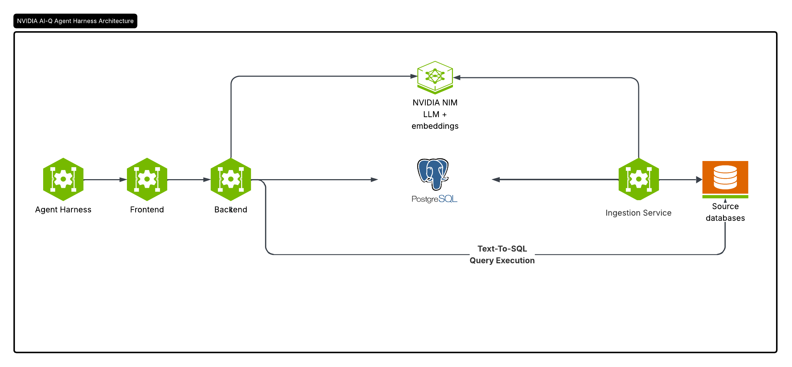
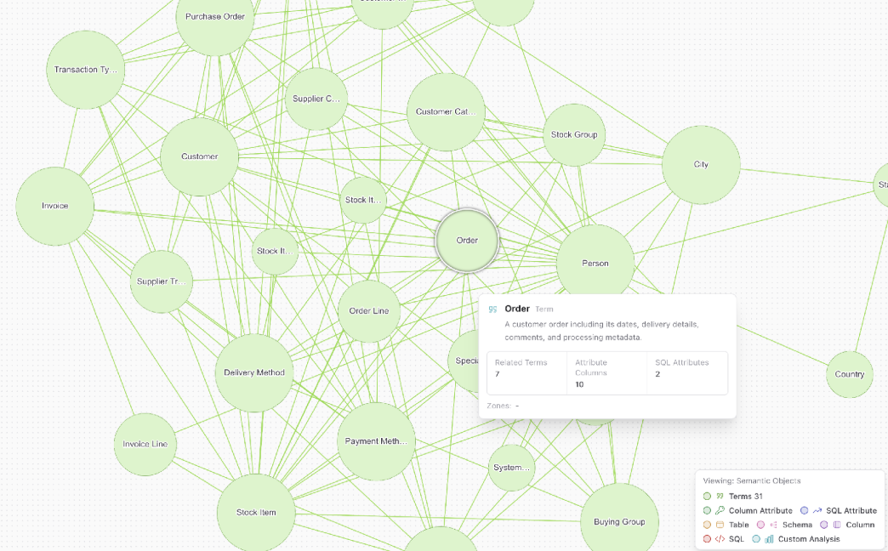
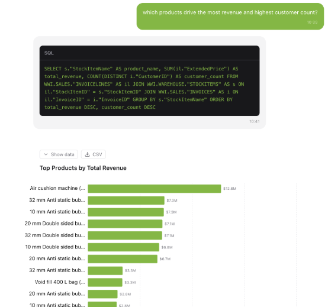

<!--
SPDX-FileCopyrightText: Copyright (c) 2026, NVIDIA CORPORATION & AFFILIATES.
All rights reserved.
SPDX-License-Identifier: Apache-2.0
-->

# Auto-Ontology

An open context layer that helps agents give fewer wrong answers on enterprise data.

[](./LICENSE)
[](./docs/)

## Why Auto-Ontology

Agents can retrieve documents and query databases, but reliability is what gates
agentic analytics: a revenue figure delivered faster is worth nothing if it's
wrong. Before an agent queries, it needs to know where the data lives, what it
means, whether to use it, how to use it, where it came from, and what is
similar.

Auto-Ontology is a service you run next to your databases to give agents that
context. It compiles their metadata into an ontology: business terms mapped to
columns, reviewed SQL for measures, and the relationships between tables. Agents
query through the ontology, and people review it in a web UI. It complements the
semantic models you already own.

With Auto-Ontology, developers can:

- **Discover.** Generate an ontology from database metadata, import existing
  semantic models, and explore the result as a semantic graph.
- **Ground.** Give agents one definition per business concept, mapped across
  tables and databases.
- **Certify.** Review, edit, and certify definitions in the UI or through the
  API.
- **Validate.** Check whether a question is answerable before querying, and
  return the SQL and the agent's steps with each answer.
- **Expose.** Serve context to any agent harness through MCP, agent skills, and
  a REST API.

The usual shortcut is to paste the schema into the agent's context window.
Auto-Ontology gives the agent tools over the ontology:

|                        | Schema in the context window            | Auto-Ontology tools                                 |
| ---------------------- | --------------------------------------- | --------------------------------------------------- |
| Tokens                 | Grow with every table and column        | Only the terms and tables the question touches      |
| Meaning                | Column names; the agent infers the rest | Business terms mapped to columns and SQL            |
| Joins and measures     | Improvised per question                 | Resolved relationships and reviewed SQL expressions |
| Unanswerable questions | Answered confidently, often wrongly     | Answerability check, so the agent asks to clarify   |

## Evaluation

The companion repository,
[auto-ontology-eval](https://github.com/NVIDIA/auto-ontology-eval), measures
ontology performance on benchmarks and evals.

For BIRD, BEAVER, FDABench-Lite, and Wide World Importers, each eval item pairs
a question with gold SQL, and a run asks every question of the same model
twice:

- **Control.** The model gets the database schema in its prompt.
- **Treatment.** Auto-Ontology's question-answering agent, the one behind Chat,
  works from the compiled ontology.

A deterministic verifier scores the SQL from each arm by execution match, using
each benchmark's official rule where it has one. The report gives the accuracy
difference and lists the questions the ontology fixed and the ones it broke.
BIRD-Interact, a multi-turn benchmark where the agent asks clarifying
questions, runs on its own harness.

To run the comparison on BIRD, follow the auto-ontology-eval setup, then run:

```bash
uv run python main.py --database-name bird
```

## Quickstart

This runs Auto-Ontology with Docker Compose against Wide World Importers,
Microsoft's sample sales database. You need Docker with Compose v2,
[uv](https://docs.astral.sh/uv/), and an NVIDIA API key (`nvapi-...`) from
[build.nvidia.com](https://build.nvidia.com).

1. Clone the repository and create `.env`:

   ```bash
   git clone https://github.com/NVIDIA/auto-ontology.git && cd auto-ontology
   cp .env.example .env
   ```

   Then set these values in `.env`:

   ```dotenv
   DEFAULT_MODELS_API_KEY=nvapi-...
   AUTH_SECRET=<a long random string, e.g. from openssl rand -base64 32>
   APP_URL=http://localhost:3000
   POSTGRES_PASSWORD=<a new password>
   CONNECTION_STRINGS=postgresql://postgres:<the same password>@postgres:5432/wideworldimporters
   AUTO_ONTOLOGY_ADMIN_PASSWORD=<a new password>
   PGADMIN_PASSWORD=<a new password>
   ```

   Compose publishes Postgres, pgAdmin, and the web app on the host, so replace
   each default password before you start it. `.env.example` also sets an API
   key per model role: replace each `nvapi-your-api-key-here` with your key, or
   delete those lines so they fall back to `DEFAULT_MODELS_API_KEY`.

2. Start Postgres and load the sample database. The seed script lives in
   auto-ontology-eval; pass it the Postgres password you set:

   ```bash
   docker compose up -d --wait postgres
   git clone https://github.com/NVIDIA/auto-ontology-eval.git ../auto-ontology-eval
   (cd ../auto-ontology-eval && uv sync && cp .env.example .env && \
     POSTGRES_PASSWORD='<the same password>' \
     uv run python scripts/seed/seed_wwi.py --database-name wideworldimporters --drop)
   ```

3. Build and start the rest of the stack:

   ```bash
   docker compose up -d --build
   ```

4. Open <http://localhost:3000> and sign in with `AUTO_ONTOLOGY_ADMIN_EMAIL` and
   `AUTO_ONTOLOGY_ADMIN_PASSWORD` from `.env`. Go to **Settings → Semantic
   Compilation** and turn it on. Ingestion runs at startup; compilation starts
   immediately and reports **Semantic compilation is ready** when it finishes.

5. Ask a question in **Chat**:

   > What was revenue for the USB food flash drive - sushi roll in Pennsylvania
   > in June 2015?

   The agent resolves *revenue*, *product*, and *state* to terms in the
   ontology, follows their relationships to the joins it needs, and runs the
   query. The answer comes back with its SQL and the steps that produced it,
   so you can check the result against the source:

   ```text
   Answer:  Revenue for USB food flash drive - sushi roll in Pennsylvania in
            June 2015 was $588.80, from 3 invoice lines.

   SQL:     SELECT SUM(il.extendedprice) AS revenue, COUNT(*) AS invoice_lines
            FROM sales.invoicelines il
            JOIN sales.invoices i             ON il.invoiceid = i.invoiceid
            JOIN warehouse.stockitems si      ON il.stockitemid = si.stockitemid
            JOIN sales.customers c            ON i.customerid = c.customerid
            JOIN application.cities ct        ON c.deliverycityid = ct.cityid
            JOIN application.stateprovinces sp ON ct.stateprovinceid = sp.stateprovinceid
            WHERE si.stockitemname = 'USB food flash drive - sushi roll'
              AND sp.stateprovincename = 'Pennsylvania'
              AND i.invoicedate >= '2015-06-01' AND i.invoicedate < '2015-07-01'

   Steps:   Resolved terms: Invoice Line (revenue), Stock Item, State Province, Invoice
            Joined: invoice line -> invoice -> customer -> city -> state province
            Validated the filter values against the data, then executed
   ```

6. Ask something the data can't answer. Wide World Importers has no
   advertising data, so a question about ad spend has nothing to resolve
   against. An agent connected through [MCP](#mcp-server) checks answerability
   first and asks you to clarify:

   ```text
   You:    What was return on ad spend for the sushi roll flash drive in June 2015?
   Agent:  check_answerable -> coverage 0.5; no term covers "ad spend"
   Agent:  I can find revenue for that product, but this data has no
           advertising spend, so I can't compute return on ad spend. Do you
           want June 2015 revenue instead, or is ad spend tracked in another
           source I should connect?
   ```

If the UI loads without its left navigation after a restart, the browser is
holding a stale session cookie. Clear site data for `localhost:3000` and sign in
again. For other setup failures, see the
[setup skill's troubleshooting guide](./skills/nvidia-ontology-setup/references/troubleshooting.md).

## How it works

<p>

</p>

Auto-Ontology works in three stages: it generates an ontology, people certify
it, and the agent answers questions from it.

The ontology holds three kinds of definition:

- **Terms.** Business concepts such as *Customer* or *Invoice Line*, each with a
  description and synonyms, mapped to the columns that hold them.
- **SQL attributes.** Reviewed SQL expressions under a term, such as a margin or
  a rolling total. The agent reuses them, so answers compute each measure the
  same way.
- **Relationships.** How tables join, including bridge tables, inferred from
  keys and from the data.

**Generate.** The ingestion service builds a first draft from the source
databases:

1. Read sources: extract schemas, profile columns, and sample values into the
   catalog.
2. Name entities: extract terms table by table and map each to columns.
3. Resolve relationships: infer joins between tables and bridge tables, and
   suggest SQL attributes from query history.
4. Write the ontology: store terms, relationships, and SQL attributes in
   Postgres, with embeddings in pgvector for retrieval.

The result is a semantic graph you can explore in the UI. In this example, one
compilation of Wide World Importers produced 31 terms; selecting **Order** shows
its description, related terms, mapped columns, and SQL attributes:

<p>

</p>

**Certify.** People make the draft trustworthy:

1. Test with real questions in Chat, or with `check_answerable` and
   `ask_question` over MCP.
2. Refine terms, descriptions, and SQL attributes in the UI or through the API.
3. Certify names, descriptions, and SQL attributes once they're correct.

**Answer.** For each question, the agent:

1. Classifies the intent and extracts the entities the question names.
2. Retrieves candidate terms, columns, and SQL attributes by embedding search.
3. Writes SQL from those candidates.
4. Checks the filter values and the query against the database, repairing the
   SQL when a check fails.
5. Runs the query and returns the answer with its SQL and the steps it took.

When the candidates can't support a query, the agent reports that the question
can't be answered from this data. Predictive questions go to KumoRFM when it's
configured (see [Predictions](#predictions)).

In Chat, each answer shows its SQL, and you can view the rows, download them as
CSV, or read them as a chart:

<p>

</p>

Auto-Ontology is compatible with [Apache Ossie](https://ossie.apache.org/), the
open standard for exchanging semantic models. Ossie includes a
[converter for Auto-Ontology](https://github.com/apache/ossie/tree/ef91cb61092c60f4b918016a81cfdbe483e113bc/converters/nvidia),
which Auto-Ontology uses to import and export model definitions as Ossie YAML.
Use **Settings → Import / Export**, or `POST /api/model/import` and
`POST /api/model/export`.

| Component           | Technology                        | Role                                       | Port |
| ------------------- | --------------------------------- | ------------------------------------------ | ---- |
| Frontend            | Next.js, Better Auth, Prisma      | Web UI, authentication, public API gateway | 3000 |
| Backend             | FastAPI (Python 3.12+), LangChain | Text-to-SQL agent, catalog, ontology APIs  | 3001 |
| Ingestion service   | FastAPI (Python 3.12+)            | Ingestion and semantic compilation         | 3002 |
| MCP server          | FastMCP                           | Read-only agent tools over the public API  | 3003 |
| Postgres + pgvector | PostgreSQL 17                     | Catalog, ontology, app data, vector store  | 5432 |
| HashiCorp Vault     | Optional                          | Connection credential storage              | n/a  |

Keep ports 3001 and 3002 on a private network. FastAPI trusts the user identity
the frontend forwards in the `x-auto-ontology-user-id` header, and the ingestion
service's endpoints (ingest, delete, reset, compile) have no authentication of
their own. Clients go through the web app on port 3000.

## Use it from your agent

### MCP server

The [MCP](https://modelcontextprotocol.io) server gives any MCP client read-only
tools over the ontology. Each user signs in through Auto-Ontology, and every
call runs with that user's permissions.

| Job           | Tools                                                         |
| ------------- | ------------------------------------------------------------- |
| Readiness     | `check_readiness`: can this deployment answer anything at all |
| Terms         | `search_terms`, `get_term`, `get_term_columns`, `get_term_sql_attributes`, `get_sql_attribute`, `describe_table` |
| Answerability | `check_answerable`: does the ontology cover this question     |
| Questions     | `ask_question`: the answer, the SQL, and the rows             |

Run the server against your deployment:

```bash
AUTO_ONTOLOGY_API_URL=http://localhost:3000 \
  uvx --from "git+https://github.com/NVIDIA/auto-ontology.git#subdirectory=mcp" auto-ontology-mcp
```

Cursor (`~/.cursor/mcp.json`):

```json
{
  "mcpServers": {
    "auto-ontology": { "url": "http://localhost:3003/mcp" }
  }
}
```

Claude Desktop (`claude_desktop_config.json`), bridged with
[`mcp-remote`](https://www.npmjs.com/package/mcp-remote):

```json
{
  "mcpServers": {
    "auto-ontology": {
      "command": "npx",
      "args": ["mcp-remote", "http://localhost:3003/mcp"]
    }
  }
}
```

Restart the client after editing its config, then sign in when it prompts.
Sign-in, configuration, and troubleshooting are in [docs/mcp.md](./docs/mcp.md).

### Agent skills

Three skills teach a coding agent to work with Auto-Ontology. Start at
[AGENTS.md](./AGENTS.md).

| Skill                                                                | Covers                                               |
| -------------------------------------------------------------------- | ---------------------------------------------------- |
| [`nvidia-ontology-setup`](./skills/nvidia-ontology-setup/)           | Install, connect sources, compile, prove readiness   |
| [`nvidia-ontology-management`](./skills/nvidia-ontology-management/) | Inspect, model, certify, import/export, and publish  |
| [`nvidia-ontology-query`](./skills/nvidia-ontology-query/)           | Ask questions and validate the SQL, rows, and answer |

### REST API

Ask a question with `POST /api/chat/completions` on the web app's origin. Mint
an API token under the user menu → **API Tokens**. The response is a
server-sent event stream: a `result` event carries the answer, and
`data: [DONE]` ends the stream.

```bash
curl -N http://localhost:3000/api/chat/completions \
  -H "x-api-key: $AUTO_ONTOLOGY_API_TOKEN" \
  -H "Content-Type: application/json" \
  -d '{"question": "How many orders shipped last week?"}'
```

```python
import json
import os

import requests

response = requests.post(
    "http://localhost:3000/api/chat/completions",
    headers={"x-api-key": os.environ["AUTO_ONTOLOGY_API_TOKEN"]},
    json={"question": "How many orders shipped last week?"},
    stream=True,
    timeout=900,
)
response.raise_for_status()

for line in response.iter_lines(decode_unicode=True):
    if not line or not line.startswith("data:"):
        continue
    payload = line.removeprefix("data:").strip()
    if payload == "[DONE]":
        break
    event = json.loads(payload)
    if event["type"] == "result":
        print(event["answer"]["response"])
        print(event["answer"]["sql_code"])
    elif event["type"] == "error":
        raise RuntimeError(event["message"])
```

Event types, multi-turn conversations, and the gateway trust boundary are in
[docs/conversation-api.md](./docs/conversation-api.md). Every other operation is
in the [OpenAPI spec](./docs/openapi/auto-ontology-api.json).

## Connectors, models, and predictions

### Sources

Auto-Ontology connects to ten engines:

- PostgreSQL
- MySQL
- Databricks
- Snowflake
- ClickHouse
- Trino
- Apache Kyuubi
- HeavyDB
- DuckDB
- SQLite

Add connections under **Settings → Connections**, or list them in
`CONNECTION_STRINGS`. DuckDB and SQLite are connection-string only. See
[docs/connections.md](./docs/connections.md) for URL schemes, scoping, and
credential storage.

### Models

Auto-Ontology uses four model roles. With an `nvapi-` key, each defaults to an
NVIDIA NIM on [build.nvidia.com](https://build.nvidia.com):

| Role            | Default model                           | What it does                                                                                                                   |
| --------------- | --------------------------------------- | ------------------------------------------------------------------------------------------------------------------------------ |
| `REASONING`     | `nvidia/nemotron-3.5-lightning-30b-a3b` | Builds the ontology (terms, relationships, SQL attributes), writes each answer's SQL and explanation, and grades answerability |
| `NON_REASONING` | `nvidia/nemotron-3.5-lightning-30b-a3b` | Runs the agent's faster steps: question intent, entity extraction, candidate selection, and SQL checks and repair              |
| `EMBED`         | `nvidia/nemotron-3.5-embed-1b`          | Indexes tables, columns, terms, and SQL attributes in pgvector, and matches each question to them                              |
| `RERANK`        | `nvidia/nemotron-3.5-rerank-8b`         | Ranks candidate tables when compilation builds bridge-table SQL attributes                                                     |

To use self-hosted NIM or any OpenAI-compatible endpoint, set
`<ROLE>_ENDPOINT`, `<ROLE>_API_KEY`, and `<ROLE>_MODEL`. Any field you leave
unset falls back to `DEFAULT_MODELS_<FIELD>`, so the simplest setup fills in
`DEFAULT_MODELS_*` and overrides only what differs. Use models
that support structured output, and keep the embedding model the same for
ingestion and queries. [`.env.example`](./.env.example) documents every
variable.

### Predictions

Set `KUMO_RFM_API_KEY` and the agent routes predictive questions to KumoRFM.
KumoRFM is a hosted service: to answer, the agent uploads the connected tables
to it, capped by `KUMO_MAX_TABLES` (20 by default) and
`KUMO_MAX_ROWS_PER_TABLE` (unlimited unless set). Review what that sends, and
complete your organization's data review, before you enable it.

## Integrate with us

To integrate an agent platform, application, or storage provider with
Auto-Ontology,
[open an integration request](https://github.com/NVIDIA/auto-ontology/issues/new?template=integration.yml).

The Auto-Ontology team maintains the code and doesn't accept external pull
requests. Integration requests and bug reports are welcome as issues. Report
security vulnerabilities through [SECURITY.md](./SECURITY.md). Maintainer
workflow is in [CONTRIBUTING.md](./CONTRIBUTING.md).

## Reference

| Topic                                   | Doc                                                  |
| --------------------------------------- | ---------------------------------------------------- |
| Kubernetes deployment with Helm         | [DEPLOYMENT.md](./DEPLOYMENT.md)                     |
| Connections, scoping, and Vault         | [docs/connections.md](./docs/connections.md)         |
| Authentication, SSO, and API tokens     | [docs/authentication.md](./docs/authentication.md)   |
| Conversation API                        | [docs/conversation-api.md](./docs/conversation-api.md) |
| MCP server                              | [docs/mcp.md](./docs/mcp.md)                         |
| REST API                                | [docs/openapi/auto-ontology-api.json](./docs/openapi/auto-ontology-api.json) |

## License

Auto-Ontology is licensed under the [Apache License, Version 2.0](./LICENSE).
SPDX identifier: `Apache-2.0`.

Each NVIDIA-authored source file in this repository carries an SPDX header
of the form:

```text
SPDX-FileCopyrightText: Copyright (c) 2024-2026, NVIDIA CORPORATION & AFFILIATES.
All rights reserved.
SPDX-License-Identifier: Apache-2.0
```

Third-party open-source components used by Auto-Ontology are enumerated, with their
upstream licenses and project URLs, in
[`THIRD_PARTY_NOTICES.md`](./THIRD_PARTY_NOTICES.md). Components added by the
container images are listed separately in
[`CONTAINER_THIRD_PARTY_NOTICES.md`](./CONTAINER_THIRD_PARTY_NOTICES.md).

## Notice and Disclaimer

NOTICE AND DISCLAIMER: This software automatically retrieves, accesses or
interacts with external materials. Those retrieved materials are not
distributed with this software and are governed solely by separate terms,
conditions and licenses. You are solely responsible for finding, reviewing and
complying with all applicable terms, conditions, and licenses, and for
verifying the security, integrity and suitability of any retrieved materials
for your specific use case. This software is provided "AS IS", without warranty
of any kind. The author makes no representations or warranties regarding any
retrieved materials, and assumes no liability for any losses, damages,
liabilities or legal consequences from your use or inability to use this
software or any retrieved materials. Use this software and the retrieved
materials at your own risk.

External materials Auto-Ontology interacts with at run time:

- Model endpoints you configure, by default the NVIDIA API catalog
  (`integrate.api.nvidia.com`, `ai.api.nvidia.com`), under each provider's and
  model's terms.
- The KumoRFM service, only when `KUMO_RFM_API_KEY` is set, under Kumo's terms.
- Your source databases, under your agreements for those systems.

## Security

Report security vulnerabilities as described in [SECURITY.md](./SECURITY.md).
