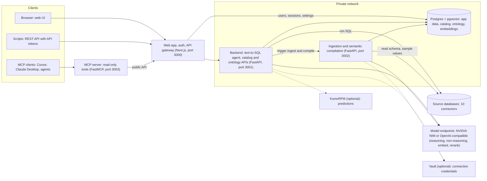
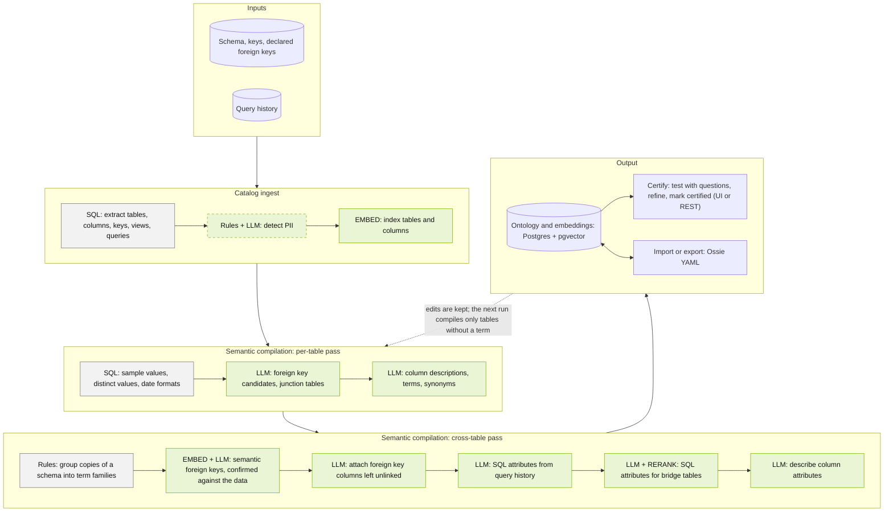
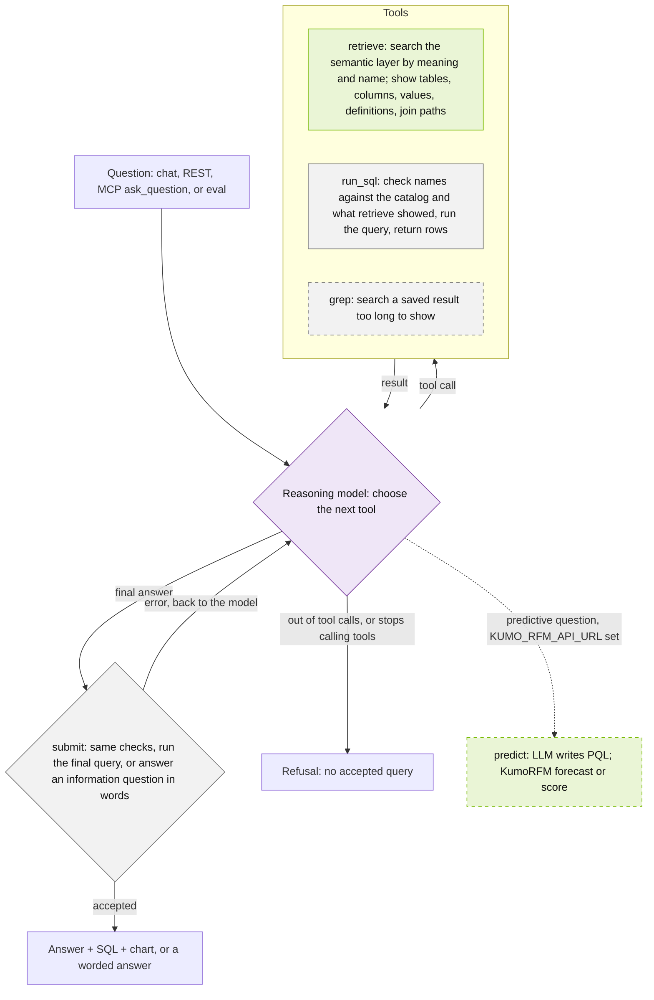

<!--
SPDX-FileCopyrightText: Copyright (c) 2026, NVIDIA CORPORATION & AFFILIATES.
All rights reserved.
SPDX-License-Identifier: Apache-2.0
-->

# Auto-Ontology architecture

This page lists every step Auto-Ontology runs to generate an ontology and to
answer a question: what each step does, whether it calls a model, whether it
runs by default, and the setting that controls it. The
[README](../README.md#how-it-works) has the short version.

Model roles are the four in [Models](../README.md#models): `REASONING`,
`NON_REASONING`, `EMBED`, and `RERANK`. "LLM" below names which of the first
two a step uses.

- [Services](#services)
- [Generate an ontology](#generate-an-ontology)
- [Answer a question](#answer-a-question)
- [Check answerability](#check-answerability)
- [Settings](#settings)

## Services



| From | To | Why |
| --- | --- | --- |
| Browser, REST scripts | Web app (3000) | All client traffic, authenticated by Better Auth sessions or API tokens |
| MCP server (3003) | Web app (3000) | Calls the public API as the signed-in user (`AUTO_ONTOLOGY_API_URL`) |
| Web app | Backend (3001) | Proxies `/api/...` and forwards the user identity (`PYTHON_API_URL`) |
| Web app | Postgres | Users, sessions, settings (Prisma, `frontend` schema) |
| Backend | Ingestion service (3002) | Triggers ingest, delete, reset, and compile (`INGESTION_SERVICE_URL`) |
| Backend, ingestion service | Postgres + pgvector | Catalog, ontology, embeddings (`public` schema) |
| Backend, ingestion service | Source databases | Answer queries; extract schemas and sample values |
| Backend, ingestion service | Model endpoints | Every model call below |
| Backend, ingestion service | Vault (optional) | Connection credentials, when Vault is configured (`VAULT_ADDR` and related variables) |
| Backend | KumoRFM (optional) | Predictions, when `KUMO_RFM_API_URL` is set |

The MCP server isn't part of Docker Compose or the Helm chart; run it next to
your deployment as described in [docs/mcp.md](./mcp.md). Keep ports 3001 and
3002 on a private network: the backend trusts the identity the web app
forwards, and the ingestion service has no authentication of its own.

## Generate an ontology



Green: model call. Gray: deterministic (SQL or rules). Dashed: off by default or optional.

Catalog ingest runs in the ingestion service at startup and whenever a
connection is added. Semantic compilation is off until an admin turns it on in
**Settings → Semantic Compilation**; then it runs at startup, every 24 hours,
and on demand. Each compilation processes only tables that don't have a term
yet, so terms you've edited are kept.

### Inputs

| Input | Source | Required |
| --- | --- | --- |
| Tables, columns, views, primary keys, declared foreign keys | Each connection | Yes |
| Query history | The connector, where the engine exposes it (for example Snowflake's `QUERY_HISTORY`) | No |
| Custom analyses (saved SQL) | Created in the UI or API, or imported | No |
| Prior ontologies and semantic models | **Settings → Import / Export** (Ossie YAML) | No |

### Catalog ingest

`auto_ontology/ingestion_service/ingest.py` (`run_ingest`)

| Step | Kind | Default | Controlled by |
| --- | --- | --- | --- |
| Extract tables, columns, keys, views, and query history | SQL | On | Connections (**Settings → Connections** or `CONNECTION_STRINGS`) |
| Detect PII and tag columns | Rules first, then `REASONING` LLM for columns the rules can't decide | Off | **Settings → PII Settings** |
| Embed tables and columns into pgvector | `EMBED` | On | `EMBED_*` |
| Replay tagging rules (only when compilation is off) | Rules | On when rules exist | **Settings → Rules** |

### Per-table pass

`auto_ontology/semantic/visit_enter.py` (`process_table`), three tables at a
time. All LLM calls in compilation use the `REASONING` model, capped at
`SEMANTIC_LLM_MAX_INFLIGHT` (6) concurrent requests.

| Step | Kind | Default | Controlled by |
| --- | --- | --- | --- |
| Sample up to 1,000 rows; mark a column unique when at least 95% of its sampled values are distinct (`distinct_ratio`); keep the lowest distinct values of suspected key columns | SQL | On | Needs a live connection |
| Distinct values of low-cardinality columns | SQL | On | **Settings → Semantic Compilation → Distinct Value Scanning** |
| Infer date formats from samples | Rules (`semantic/date_format.py`) | On | — |
| Find foreign key candidates; mark junction tables | LLM, merged with declared keys (`semantic/fk_suggester.py`) | On | — |
| Write column descriptions | LLM (`semantic/deterministic.py`) | On | — |
| Name terms, with descriptions, synonyms, and display names | LLM (`semantic/term_extractor.py`) | On | — |
| Embed terms | `EMBED` (`semantic/embed.py`) | On | — |
| Propose derived-metric SQL attributes from each term's columns | LLM + rules (`semantic/sql_attribute_extractor.py`) | Off | `ENABLE_TABLE_SQL_ATTRIBUTES` |

### Cross-table pass

`auto_ontology/semantic/compile.py` (`run_semantic_compilation`)

| Step | Kind | Default | Code |
| --- | --- | --- | --- |
| Group tables that are copies of one schema told apart by a name prefix (`OLD_ROOMS`, `NEW_ROOMS`) into term families, so later stages can tell the copies apart | Rules (+ `EMBED` to re-index changed attributes) | On | `semantic/term_families.py` (`resolve_term_families`) |
| Link each foreign key column to the term attribute it references: declared key first; otherwise embedding search and an LLM pick, confirmed by comparing the two columns' distinct values, then a shortlist of keys whose values hold the column's. An inferred link is stored only if joining the two columns returns a row (retried with both sides cast to text), and never points into another family's copy of a table | `EMBED` + LLM + SQL | On (`PREVENT_SEMANTIC_FK_DB_QUERIES` turns off the value and join checks) | `semantic/semantic_fk.py` (`resolve_semantic_fks`) |
| Choose one default join per group of alternative links | LLM, deterministic fallback | On | `select_semantic_fk_join_defaults` |
| Attach foreign key columns no link was found for to their table's term, or to a new term for a junction table | LLM + `EMBED` | On | `semantic/unmatched_fks.py` (`attach_unmatched_fk_columns`) |
| Suggest SQL attributes from up to 10 expressions per term in query history. Usage ranking isn't active yet, so these are the first 10 found, not the most used | Parse (rules) + LLM | On | `semantic/sql_attribute_suggester.py` |
| Write SQL attributes for bridge tables; the reranker picks the term that owns each | LLM + `RERANK` | On | `semantic/bridge_tables.py` |
| Describe each column attribute in one sentence from its term, column, samples, format, the foreign keys at either end, and its family | LLM | On | `semantic/attribute_descriptions.py` (`describe_column_attributes`) |
| Replay tagging rules over the catalog and ontology | Rules | On when rules exist | `ingestion_service/semantic_scheduler.py` |

`RERANK` is used only in the bridge-table step. Answering doesn't call it.

### Output and certification

- The ontology lives in Postgres (terms, column attributes, SQL attributes,
  semantic foreign keys) with embeddings in pgvector.
- Test the draft with real questions in Chat, or with `check_answerable` and
  `ask_question` over MCP.
- Refine terms, descriptions, SQL attributes, and relationships in the UI or
  through the REST API. Edits are re-embedded when saved, so the next question
  uses them, and the next compilation keeps them: it compiles only tables that
  don't have a term yet. One exception: every compilation re-selects which
  semantic foreign key each join uses, so turning one off doesn't stick.
- Certifying a name, description, or attribute marks it as reviewed in the UI
  and in search results. It doesn't change how the agent retrieves.
- Import and export model definitions as Ossie YAML with **Settings → Import /
  Export**, `POST /api/model/import`, or `POST /api/model/export`.

## Answer a question

**ReAct, model-chosen tools.** The answering agent is a loop: the
`REASONING` model starts with no schema and decides which tool to call next
(`auto_ontology/retrieval/text_to_sql/react/`). Its system prompt carries the
glossary definitions and custom prompts from **Settings → Semantic Input**.
Before the loop, Chat rewrites a follow-up as a standalone question with the
`NON_REASONING` model; after it, `format_and_respond` assembles the answer and
Chat draws a chart.



Green: model call. Gray: deterministic (SQL or rules). Purple: model-chosen tool (ReAct). Dashed: off by default or optional.

### Tools

| Tool | What it does | Kind | Offered |
| --- | --- | --- | --- |
| `retrieve` | Searches the semantic layer by meaning (pgvector) and by name (substring search): terms stand for tables, attributes for columns, plus definitions (SQL attributes) and analyses. Tables and columns the semantic layer doesn't describe, such as foreign keys and link tables, are searched in the catalog directly. Every hit comes back as tables and columns with their descriptions, stored values, and references; definitions with their SQL; join paths from new tables to tables already shown (`find_join_path`); and near-copies of each table. Optional `kinds` narrows to terms, attributes, definitions, or analyses. With `purpose=information`, it shows each term with its description, synonyms, attributes, and definitions instead, and an empty query lists every table, or every term with `kinds=["term"]`. | `EMBED` + SQL, no LLM | Always |
| `run_sql` | Checks the query's table and column names against the catalog of the database it runs on, suggesting the closest real names for unknown ones, and rejects tables no `retrieve` result named. Then runs it under the SQL query timeout and returns up to 100 rows | SQL, no model | Always |
| `submit` | Applies the same checks and runs the final query. A clean run is the answer; an error or a rewrite goes back to the model. For an information question, `sql` is left empty and `response` is the answer | SQL, no model | Always (with `TEXT_TO_SQL_REACT_SUBMIT_TOOL=false`, `run_sql(final=true)` answers instead) |
| `grep` | Searches all rows of a `run_sql` result too long to show | Deterministic | Off; `TEXT_TO_SQL_REACT_GREP=true` |
| `predict` | Builds a KumoRFM graph over the tables `retrieve` showed, writes PQL with the `NON_REASONING` model, and predicts. Ends the episode | `NON_REASONING` LLM + KumoRFM | Only when `KUMO_RFM_API_URL` is set |

Only the loop itself and `predict` call a language model. There's no separate
intent classifier, SQL judge, or repair model: the reasoning model reads each
tool result and decides what to do next, and the deterministic checks in
`run_sql` and `submit` reject unknown names and failing queries.

Questions about the data itself (which tables or columns exist, what a term
means, how tables connect, how a measure is defined) are answered without SQL:
the model calls `retrieve` with `purpose=information` and submits the answer in
words. Interactive analysis turns this off and always asks for SQL
(`calculation_only`).

### Multi-hop dependency queries

The SQL agent can trace recorded dependencies across several tables in one
source database. The question “Which release was deployed to the component
recorded on incident 42?” can use the catalog path below.

```text
incidents.component_id = components.id
components.deployment_id = deployments.id
deployments.release_id = releases.id
```

When `retrieve` finds the endpoint tables, it can show the join columns and
name both intermediate tables. The agent can then use those tables in a SQL
query. The route uses eligible semantic foreign keys and their owning columns.
Traversal is bounded and prefers a shortest path. A reverse hop requires the
owner column to be a declared primary key. If an intermediate link is missing,
that chain cannot supply a route.

Entities in this workflow are grounded in source tables and columns. Compiled
terms and attributes help retrieve those catalog objects under different names.
The path itself follows stored column identities and joins. To match
labels across free-text extractions, an unstructured document corpus would
need a separate extraction and entity-resolution step to produce these objects.

The example can answer which release the source records, or trace a cause
already recorded in the source if its relationship is modeled. Determining
whether that release caused the incident would require causal evidence and
analysis beyond this join path.

The [incident dependency fixture](../auto_ontology/dal/tests/test_attributes.py)
checks the three-hop route and its missing-link variant with a real ontology
store. It exercises catalog name search and `retrieve` without model calls, so
it measures path retrieval independently of natural-language SQL generation.
Set up the test database as described in [CONTRIBUTING.md](../CONTRIBUTING.md#checks-before-a-pull-request) before running the fixture.

```bash
uv run pytest auto_ontology/dal/tests/test_attributes.py -k recorded_incident
```

### Stop conditions

| End | Result |
| --- | --- |
| `submit` runs cleanly | Answer, SQL, rows (and a chart in Chat) |
| `submit` with no SQL, for an information question | Answer in words |
| `predict` runs | Forecast or score with an explanation |
| Tool budget used up | Refusal. On the last turn only the answering tool is offered |
| No tool call after two nudges | Refusal |
| The model endpoint keeps failing | Refusal |

The ReAct agent doesn't ask clarifying questions.

### Limits

| Variable | Default | Bounds |
| --- | --- | --- |
| `TEXT_TO_SQL_REACT_MAX_TOOL_CALLS` | 24 | Tool calls per question |
| `TEXT_TO_SQL_REACT_MAX_SQL_RUNS` | 10 | `run_sql` calls per question |
| `TEXT_TO_SQL_REACT_MAX_PREDICT_CALLS` | 2 | `predict` calls per question |
| `TEXT_TO_SQL_REACT_MODEL_RETRIES` | 6 | Attempts per model call |
| `TEXT_TO_SQL_REACT_MAX_OBSERVATION_CHARS` | 8000 | Characters of one tool result |
| `TEXT_TO_SQL_REACT_MAX_RESULT_ROWS` | 100 | Rows `run_sql` shows |
| `TEXT_TO_SQL_REACT_MAX_TABLES_PER_RETRIEVE` | 6 | Tables one `retrieve` introduces |
| `TEXT_TO_SQL_REACT_MAX_COLUMNS_PER_TABLE` | 25 | Columns shown for a wide table |
| `TEXT_TO_SQL_REACT_MAX_SIBLING_COUNTS` | 4 | Row counts one `retrieve` runs for near-copy tables |
| `TEXT_TO_SQL_REACT_SIBLING_COUNT_TIMEOUT_S` | 5 | Seconds one of those row counts may run |
| `TEXT_TO_SQL_REACT_SIBLINGS` | on | `false` stops `retrieve` from showing near-copy tables and their row counts |
| `TEXT_TO_SQL_REACT_MAX_PAGE_ROWS` | 100000 | Rows `grep` saves from one result |

A repeated identical tool call isn't run again; the model is pointed to the
earlier result, and the repeat still counts against the tool budget.

### Relation to the MCP tools

None of the ReAct tools are MCP tools. The MCP server's tools
(`check_readiness`, `search_terms`, `get_term`, `get_term_columns`,
`get_term_sql_attributes`, `get_sql_attribute`, `describe_table`,
`check_answerable`, `ask_question`) call the public REST API from outside.
The ReAct tools run inside the backend and read the same catalog and ontology
directly. `retrieve` covers what the term and table tools expose, and an MCP
client reaches the ReAct agent through `ask_question`, which calls
`POST /api/chat/completions`.

## Check answerability

`POST /api/question-entity-coverage`, exposed over MCP as `check_answerable`,
grades how well the ontology covers a question without writing SQL
(`auto_ontology/retrieval/entity_coverage/`):

1. `REASONING` LLM: extract the entities the question names.
2. `EMBED` + `REASONING` LLM: search pgvector for candidate column
   attributes, SQL attributes, custom analyses, and the subject term, and keep
   the ones a model judges relevant (`CandidateRetrievalAgent`).
3. Deterministic: grade coverage as the share of entities with a candidate
   within the distance threshold.

Chat doesn't call it. An agent calls it first and decides whether to ask the
user to clarify.

## Settings

| Where | Setting | Affects |
| --- | --- | --- |
| **Settings → Connections** or `CONNECTION_STRINGS` | Source databases and connection tests | Ingest, answering |
| **Settings → Semantic Compilation** | Enable compilation, Distinct Value Scanning, Reset Semantic Layer | Generate |
| **Settings → PII Settings** | PII detection | Catalog ingest |
| **Settings → Tags**, **Rules** | Tagging rules replayed after each pass | Catalog and ontology labels |
| **Settings → Semantic Input** | Glossary definitions and custom prompts | Answering |
| **Settings → Agent Settings** | SQL query timeout, Visualize SQL Results | Answering |
| **Settings → Import / Export** | Ossie YAML import and export, Regenerate Embeddings | Ontology |
| **Settings → Single Sign-On** | SSO | Access |
| Environment (`.env`, Helm values) | `REASONING_*`, `NON_REASONING_*`, `EMBED_*`, `RERANK_*`, `DEFAULT_MODELS_*` | Every model call |
| Environment | `KUMO_RFM_API_URL`, `KUMO_RFM_API_KEY`, `KUMO_MAX_*` | Predictions |
| Environment | `TEXT_TO_SQL_REACT_*` | ReAct limits (see [Limits](#limits)) |
| Environment | `SEMANTIC_LLM_MAX_INFLIGHT`, `PREVENT_SEMANTIC_FK_DB_QUERIES`, `ENABLE_TABLE_SQL_ATTRIBUTES` | Compilation concurrency, whether foreign key inference queries the source, and whether terms get table-derived SQL attributes |

[`.env.example`](../.env.example) documents every environment variable.
