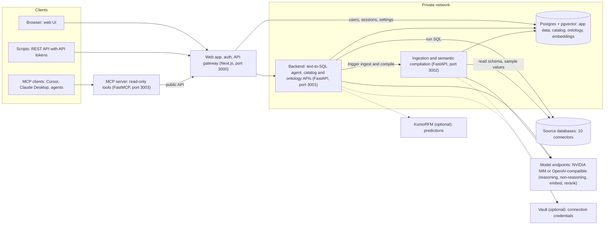
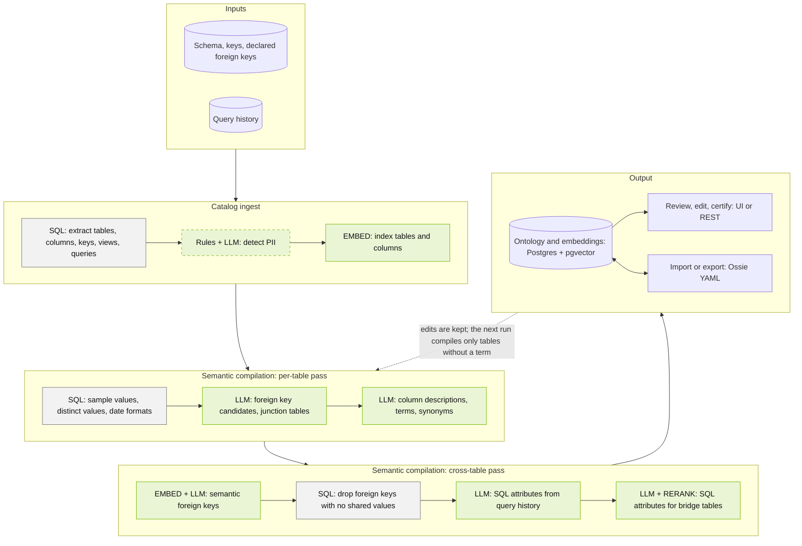
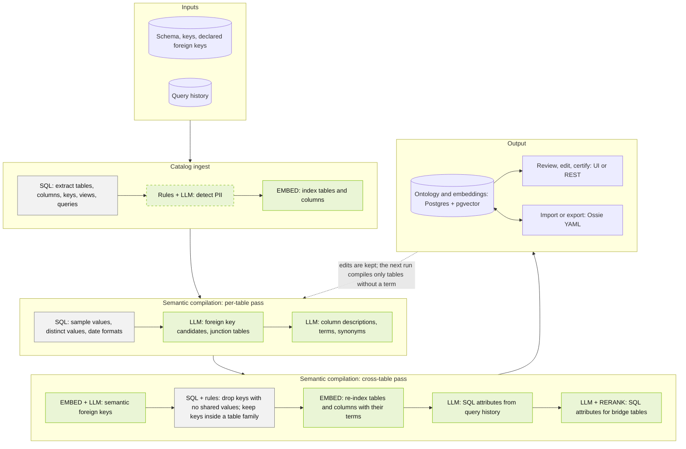
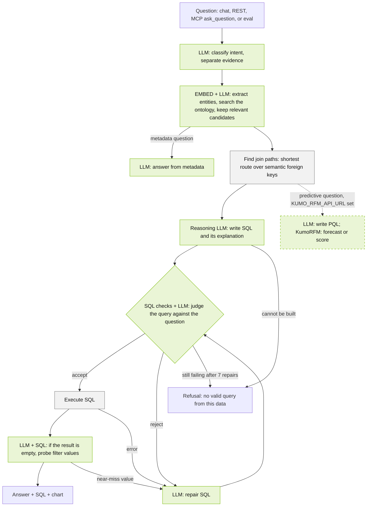
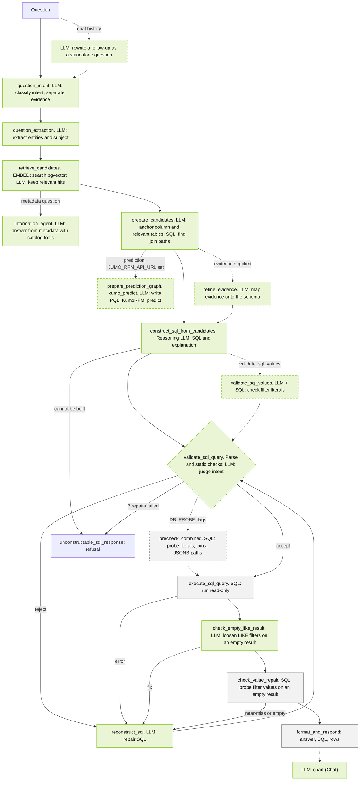
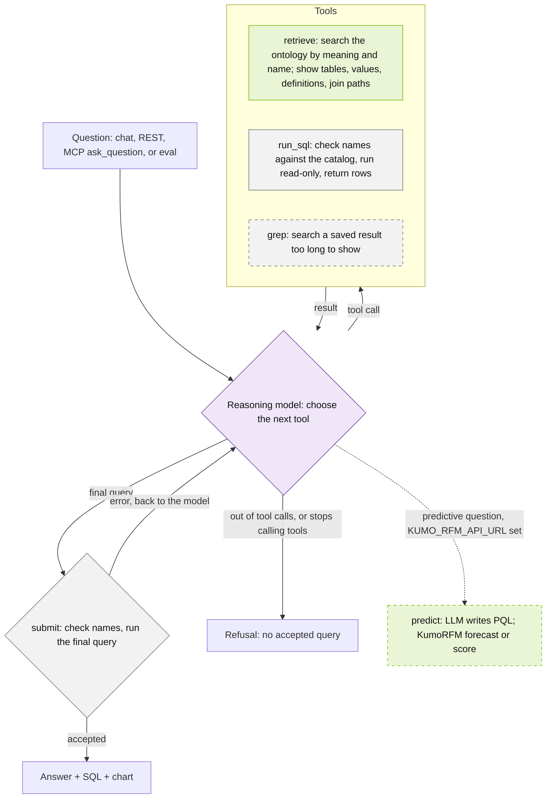

<!--
SPDX-FileCopyrightText: Copyright (c) 2026, NVIDIA CORPORATION & AFFILIATES.
All rights reserved.
SPDX-License-Identifier: Apache-2.0
-->

# Auto-Ontology architecture

This page lists every step Auto-Ontology runs to generate an ontology and to
answer a question: what each step does, whether it calls a model, whether it
runs by default, and the setting that controls it. The
[README](../README.md#how-it-works) has the short version.

Model roles are the four in [Models](../README.md#models): `REASONING`,
`NON_REASONING`, `EMBED`, and `RERANK`. "LLM" below names which of the first
two a step uses.

- [Services](#services)
- [Generate an ontology](#generate-an-ontology)
- [Answer a question, now: fixed chain](#answer-a-question-now-fixed-chain)
- [Answer a question, next: ReAct (in development)](#answer-a-question-next-react-in-development)
- [Check answerability](#check-answerability)
- [Settings](#settings)

## Services

| From | To | Why |
| --- | --- | --- |
| Browser, REST scripts | Web app (3000) | All client traffic, authenticated by Better Auth sessions or API tokens |
| MCP server (3003) | Web app (3000) | Calls the public API as the signed-in user (`AUTO_ONTOLOGY_API_URL`) |
| Web app | Backend (3001) | Proxies `/api/...` and forwards the user identity (`PYTHON_API_URL`) |
| Web app | Postgres | Users, sessions, settings (Prisma, `frontend` schema) |
| Backend | Ingestion service (3002) | Triggers ingest, delete, reset, and compile (`INGESTION_SERVICE_URL`) |
| Backend, ingestion service | Postgres + pgvector | Catalog, ontology, embeddings (`public` schema) |
| Backend, ingestion service | Source databases | Answer queries; extract schemas and sample values |
| Backend, ingestion service | Model endpoints | Every model call below |
| Backend, ingestion service | Vault (optional) | Connection credentials, when Vault is configured (`VAULT_ADDR` and related variables) |
| Backend | KumoRFM (optional) | Predictions, when `KUMO_RFM_API_URL` is set |

The MCP server isn't part of Docker Compose or the Helm chart; run it next to
your deployment as described in [docs/mcp.md](./mcp.md). Keep ports 3001 and
3002 on a private network: the backend trusts the identity the web app
forwards, and the ingestion service has no authentication of its own.

## Generate an ontology

**Now.**

Green: model call. Gray: deterministic (SQL or rules). Purple: model-chosen tool (ReAct). Dashed: off by default or optional.

Catalog ingest runs in the ingestion service at startup and whenever a
connection is added. Semantic compilation is off until an admin turns it on in
**Settings → Semantic Compilation**; then it runs at startup, every 24 hours,
and on demand. Each compilation processes only tables that don't have a term
yet, so terms you've edited are kept.

### Inputs

| Input | Source | Required |
| --- | --- | --- |
| Tables, columns, views, primary keys, declared foreign keys | Each connection | Yes |
| Query history | The connector, where the engine exposes it (for example Snowflake's `QUERY_HISTORY`) | No |
| Custom analyses (saved SQL) | Created in the UI or API, or imported | No |
| Prior ontologies and semantic models | **Settings → Import / Export** (Ossie YAML) | No |

### Catalog ingest

`auto_ontology/ingestion_service/ingest.py` (`run_ingest`)

| Step | Kind | Default | Controlled by |
| --- | --- | --- | --- |
| Extract tables, columns, keys, views, and query history | SQL | On | Connections (**Settings → Connections** or `CONNECTION_STRINGS`) |
| Detect PII and tag columns | Rules first, then `REASONING` LLM for columns the rules can't decide | Off | **Settings → PII Settings** |
| Embed tables and columns into pgvector | `EMBED` | On | `EMBED_*` |
| Replay tagging rules (only when compilation is off) | Rules | On when rules exist | **Settings → Rules** |

### Per-table pass

`auto_ontology/semantic/visit_enter.py` (`process_table`), three tables at a
time. All LLM calls in compilation use the `REASONING` model, capped at
`SEMANTIC_LLM_MAX_INFLIGHT` (6) concurrent requests.

| Step | Kind | Default | Controlled by |
| --- | --- | --- | --- |
| Sample rows (bounded `SELECT ... LIMIT`) | SQL | On | Needs a live connection |
| Distinct values of low-cardinality columns | SQL | On | **Settings → Semantic Compilation → Distinct Value Scanning** |
| Infer date formats from samples | Rules (`semantic/date_format.py`) | On | — |
| Find foreign key candidates; mark junction tables | LLM, merged with declared keys (`semantic/fk_suggester.py`) | On | — |
| Write column descriptions | LLM (`semantic/deterministic.py`) | On | — |
| Name terms, with descriptions, synonyms, and display names | LLM (`semantic/term_extractor.py`) | On | — |
| Embed terms | `EMBED` (`semantic/embed.py`) | On | — |

### Cross-table pass

`auto_ontology/semantic/compile.py` (`run_semantic_compilation`)

| Step | Kind | Default | Code |
| --- | --- | --- | --- |
| Link each foreign key column to the term attribute it references: declared key first; otherwise embedding search for the top 5 candidates and an LLM pick, falling back to a sample-value match | `EMBED` + LLM + SQL | On | `semantic/semantic_fk.py` (`resolve_semantic_fks`) |
| Drop links whose columns share no values | SQL | On | `prune_disjoint_semantic_fks` |
| Choose one default join per group of alternative links | LLM, deterministic fallback | On | `select_semantic_fk_join_defaults` |
| Suggest SQL attributes from the 10 most-used expressions per term in query history | Parse (rules) + LLM | On | `semantic/sql_attribute_suggester.py` |
| Write SQL attributes for bridge tables; the reranker picks the term that owns each | LLM + `RERANK` | On | `semantic/bridge_tables.py` |
| Replay tagging rules over the catalog and ontology | Rules | On when rules exist | `ingestion_service/semantic_scheduler.py` |

`RERANK` is used only in the bridge-table step. Answering doesn't call it.

### Next: Generate (ReAct, in development)

The ReAct work in development adds two cross-table steps after the semantic
foreign key steps. Both run by default on that branch.

| Step | Kind | Code |
| --- | --- | --- |
| Keep links inside a table family: when two copies of a schema differ only by a name prefix (`OLD_ROOMS`, `NEW_ROOMS`), move a link that crosses families onto the twin in its own family, or drop it | Rules + SQL | `semantic/table_families.py` (`resolve_table_families`) |
| Re-embed tables and columns with their terms and attributes, so a table's search text carries its term | `EMBED` | `server/datasources/service.py` (`refresh_catalog_embeddings`) |

Green: model call. Gray: deterministic (SQL or rules). Purple: model-chosen tool (ReAct). Dashed: off by default or optional.

### Output and feedback loop

- The ontology lives in Postgres (terms, column attributes, SQL attributes,
  semantic foreign keys) with embeddings in pgvector.
- Review terms, descriptions, SQL attributes, and relationships in the UI or
  through the REST API. Edits are re-embedded when saved, so the next question
  uses them.
- Certifying a name, description, or attribute marks it as reviewed in the UI
  and in search results. It doesn't change how the agent retrieves.
- Import and export model definitions as Ossie YAML with **Settings → Import /
  Export**, `POST /api/model/import`, or `POST /api/model/export`.

## Answer a question, now: fixed chain

This is the current agent, a LangGraph graph built in
`auto_ontology/retrieval/text_to_sql/text_to_sql_graph.py` (`create_graph`).
Every question runs the same steps in the same order; the routing between them
is fixed in code.

**Now: fixed chain (LangGraph), overview.**

Green: model call. Gray: deterministic (SQL or rules). Purple: model-chosen tool (ReAct). Dashed: off by default or optional.

**Now: fixed chain (LangGraph), full detail.**

Green: model call. Gray: deterministic (SQL or rules). Purple: model-chosen tool (ReAct). Dashed: off by default or optional.

| Step (graph node) | What it does | Kind | Default | Controlled by |
| --- | --- | --- | --- | --- |
| Follow-up resolution (Chat worker, before the graph) | Rewrites a follow-up as a standalone question from the conversation | `NON_REASONING` LLM | When the conversation has history | `conversation_id` |
| `question_intent` | Classifies the question as calculation, information, or prediction, and separates inline evidence | `NON_REASONING` LLM | On | `calculation_only` (library payload) forces calculation |
| `question_extraction` | Extracts the entities and subject the question names | `NON_REASONING` LLM | On | — |
| `retrieve_candidates` | Searches pgvector for column attributes, SQL attributes, custom analyses, and the subject term, then keeps the hits a model judges relevant | `EMBED` + `NON_REASONING` LLM | On | — |
| `information_agent` | Answers questions about the metadata itself with read-only catalog tools (up to 6 tool calls) | `NON_REASONING` LLM | Information questions only | — |
| `prepare_candidates` | Picks an anchor column, finds join paths from it (shortest route over semantic foreign keys, `dal/attributes.py` `find_join_path`), adds tables by embedding search, and filters tables by relevance | `NON_REASONING` LLM + `EMBED` + SQL | On | — |
| `prepare_prediction_graph`, `kumo_predict` | Builds a KumoRFM graph over the candidate tables, writes PQL, and predicts | `NON_REASONING` LLM + KumoRFM | Off | `KUMO_RFM_API_URL` (and `KUMO_RFM_API_KEY` if needed); `prediction` request field |
| `refine_evidence` | Maps user-supplied evidence onto the schema | `NON_REASONING` LLM | Only when evidence is supplied | `evidence` request field |
| `construct_sql_from_candidates` | Writes the SQL and its plain-language explanation, or declares the question unanswerable | `REASONING` LLM | On | — |
| `validate_sql_values` | Checks filter literals against the database before running | `NON_REASONING` LLM + SQL | Off in Chat and REST | `validate_sql_values` (library payload; the eval turns it on) |
| `validate_sql_query` | Parses the SQL, runs static checks, and judges whether it answers the question | Rules + `NON_REASONING` LLM | On | — |
| `reconstruct_sql` | Repairs the SQL from the error or rejection | `NON_REASONING` LLM | On a failed check | Up to 7 repairs per attempt |
| `precheck_combined` | Probes literals, join paths, and JSONB key paths before running | SQL | Off | `DB_PROBE_PROACTIVE`, `DB_PROBE_JOIN_PATH_CHECK`, `DB_PROBE_JSONB_PATH_CHECK` |
| `execute_sql_query` | Runs the query read-only | SQL | On | **Settings → Agent Settings → SQL Query Timeout** (30 s) |
| `check_empty_like_result` | On an empty result, asks a model which `LIKE` filters to loosen; also catches all-NULL JSONB columns | `NON_REASONING` LLM | On an empty result | Skipped when `shorten_answer` is set |
| `check_value_repair` | On an empty result, compares filter literals with the column's real values; a near-miss, or an undiagnosed empty result, goes back to repair once | SQL | On an empty result | — |
| `format_and_respond` | Assembles the answer, SQL, and rows | Deterministic | On | — |
| `unconstructable_sql_response` | Returns the refusal | Deterministic | When no valid query | — |
| Chart (Chat router, after the graph) | Decides whether and how to chart the rows | `NON_REASONING` LLM | On, in conversations | **Settings → Agent Settings → Visualize SQL Results** |

After 5 repairs, the post-execution checks stop blocking and let the SQL
through; the intent judge keeps running. If the graph ends in a refusal, the
whole chain reruns once from `question_intent`. If the second run also
refuses, the response carries the refusal text together with the last query
that passed the static checks but not the intent judge, unexecuted
(`main.py`, `_apply_last_deterministic_sql_fallback`).

Glossary definitions and custom prompts from **Settings → Semantic Input** are
added to the agent's prompts.

## Answer a question, next: ReAct (in development)

**Next: ReAct, model-chosen tools (in development).** The ReAct agent replaces
the fixed chain with one loop: the `REASONING` model
starts with no schema and decides which tool to call next. It is being built
on the `feat/react-ontology-agent_clean` branch and isn't in a release yet, so
the details below can change.

Green: model call. Gray: deterministic (SQL or rules). Purple: model-chosen tool (ReAct). Dashed: off by default or optional.

### Tools

| Tool | What it does | Kind | Offered |
| --- | --- | --- | --- |
| `retrieve` | Searches the ontology by meaning (pgvector) and by name (substring search). Returns matching tables with their terms, columns, stored values, and references; SQL attribute definitions; join paths from new tables to tables already shown (`find_join_path`); and near-copies of each table. Optional `kinds` narrows to tables, columns, definitions, or analyses. | `EMBED` + SQL, no LLM | Always |
| `run_sql` | Checks the query's table and column names against the catalog, suggests the closest real names for unknown ones, then runs it read-only and returns up to 100 rows | SQL, no model | Always |
| `submit` | Checks and runs the final query. A clean run is the answer; an error or a rewrite goes back to the model | SQL, no model | Always (with `TEXT_TO_SQL_REACT_SUBMIT_TOOL=false`, `run_sql(final=true)` answers instead) |
| `grep` | Searches all rows of a `run_sql` result too long to show | Deterministic | Off; `TEXT_TO_SQL_REACT_GREP=true` |
| `predict` | Builds a KumoRFM graph over the tables `retrieve` showed, writes PQL with the `NON_REASONING` model, and predicts. Ends the episode | `NON_REASONING` LLM + KumoRFM | Only when `KUMO_RFM_API_URL` is set |

Only the loop itself and `predict` call a language model. There's no separate
intent classifier, SQL judge, or repair model: the reasoning model reads each
tool result and decides what to do next, and the deterministic checks in
`run_sql` and `submit` reject unknown names and failing queries.

### Stop conditions

| End | Result |
| --- | --- |
| `submit` runs cleanly | Answer, SQL, rows (and a chart in Chat) |
| `predict` runs | Forecast or score with an explanation |
| Tool budget used up | Refusal. On the last turn only the answering tool is offered |
| No tool call after two nudges | Refusal |
| The model endpoint keeps failing | Refusal |

The ReAct agent doesn't ask clarifying questions.

### Limits

| Variable | Default | Bounds |
| --- | --- | --- |
| `TEXT_TO_SQL_REACT_MAX_TOOL_CALLS` | 24 | Tool calls per question |
| `TEXT_TO_SQL_REACT_MAX_SQL_RUNS` | 10 | `run_sql` calls per question |
| `TEXT_TO_SQL_REACT_MAX_PREDICT_CALLS` | 2 | `predict` calls per question |
| `TEXT_TO_SQL_REACT_MODEL_RETRIES` | 6 | Attempts per model call |
| `TEXT_TO_SQL_REACT_MAX_OBSERVATION_CHARS` | 8000 | Characters of one tool result |
| `TEXT_TO_SQL_REACT_MAX_RESULT_ROWS` | 100 | Rows `run_sql` shows |
| `TEXT_TO_SQL_REACT_MAX_TABLES_PER_RETRIEVE` | 6 | Tables one `retrieve` introduces |
| `TEXT_TO_SQL_REACT_MAX_COLUMNS_PER_TABLE` | 25 | Columns shown for a wide table |

A repeated identical tool call isn't run again; the model is pointed to the
earlier result.

### Relation to the MCP tools

None of the ReAct tools are MCP tools. The MCP server's tools
(`check_readiness`, `search_terms`, `get_term`, `get_term_columns`,
`get_term_sql_attributes`, `get_sql_attribute`, `describe_table`,
`check_answerable`, `ask_question`) call the public REST API from outside.
The ReAct tools run inside the backend and read the same catalog and ontology
directly. `retrieve` covers what the term and table tools expose, and an MCP
client reaches the ReAct agent through `ask_question`, which calls
`POST /api/chat/completions`.

## Check answerability

`POST /api/question-entity-coverage`, exposed over MCP as `check_answerable`,
grades how well the ontology covers a question without writing SQL
(`auto_ontology/retrieval/entity_coverage/`):

1. `NON_REASONING` LLM: extract the entities the question names.
2. `EMBED` + `NON_REASONING` LLM: retrieve candidates, as in
   `retrieve_candidates` above.
3. Deterministic: grade coverage as the share of entities with a candidate
   within the distance threshold.

Chat doesn't call it. An agent calls it first and decides whether to ask the
user to clarify.

## Settings

| Where | Setting | Affects |
| --- | --- | --- |
| **Settings → Connections** or `CONNECTION_STRINGS` | Source databases and connection tests | Ingest, answering |
| **Settings → Semantic Compilation** | Enable compilation, Distinct Value Scanning, Reset Semantic Layer | Generate |
| **Settings → PII Settings** | PII detection | Catalog ingest |
| **Settings → Tags**, **Rules** | Tagging rules replayed after each pass | Catalog and ontology labels |
| **Settings → Semantic Input** | Glossary definitions and custom prompts | Answering |
| **Settings → Agent Settings** | SQL query timeout, Visualize SQL Results | Answering |
| **Settings → Import / Export** | Ossie YAML import and export, Regenerate Embeddings | Ontology |
| **Settings → Single Sign-On** | SSO | Access |
| Environment (`.env`, Helm values) | `REASONING_*`, `NON_REASONING_*`, `EMBED_*`, `RERANK_*`, `DEFAULT_MODELS_*` | Every model call |
| Environment | `KUMO_RFM_API_URL`, `KUMO_RFM_API_KEY`, `KUMO_MAX_*` | Predictions |
| Environment | `DB_PROBE_*`, `SEMANTIC_LLM_MAX_INFLIGHT`, `TEXT_TO_SQL_REACT_*` (next) | Now: fixed-chain probes and compilation concurrency. Next: ReAct limits |

[`.env.example`](../.env.example) documents every environment variable.
